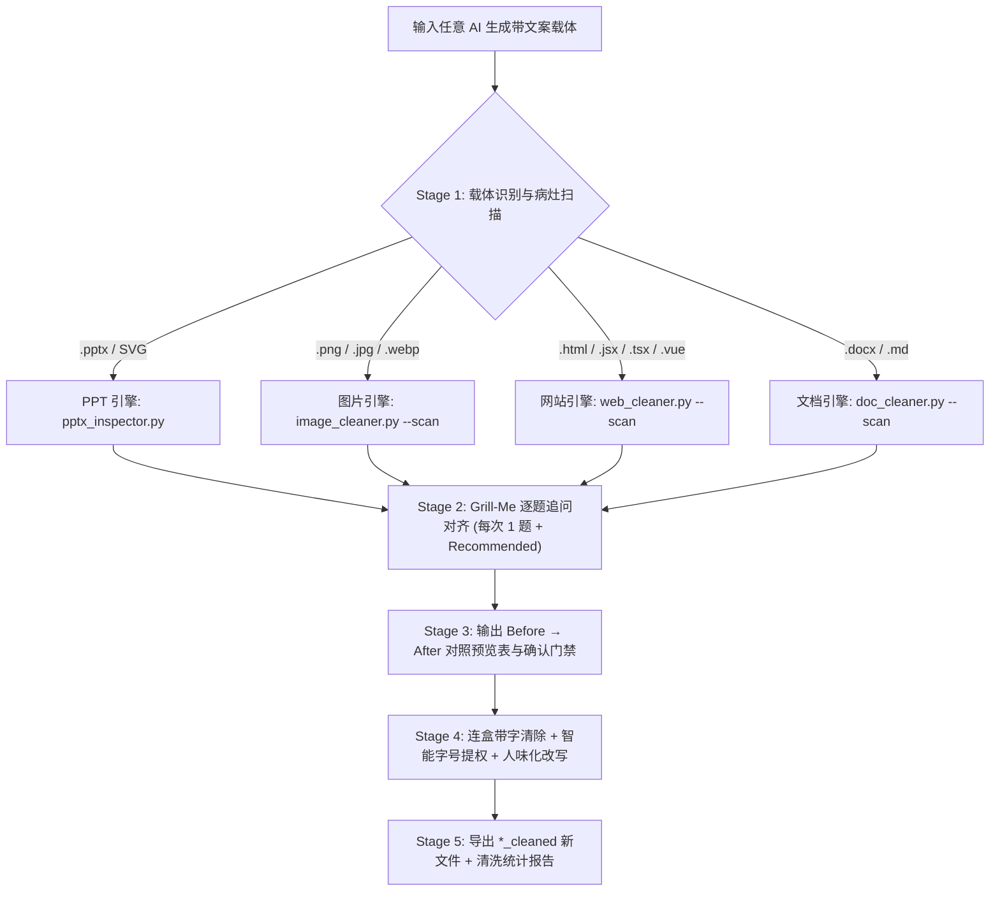

<div align="center">

# 🧹 AI Clean Master (`ai-clean-master`)

**全载体「去 AI 味小字连盒清理 + 视觉提权 + 人味化改写」大师技能**  
*All-Carrier AI-Slop Micro-Copy Cleaner, Visual Promoter & Copy Humanizer Skill*

[**简体中文**](./README.md) | [**English**](./README_EN.md)

[](LICENSE)
[](#四-四大载体专属清理引擎)
[](#三-主流-ai-agent-全平台安装与适配指南)

</div>

---

## 一、为什么你需要 `ai-clean-master`？

无论你是用 AI 生成 **PPT 演示文稿**、**信息图海报**、**网页/参赛原型 Demo**，还是 **Word/Markdown 文档**，生成物往往带着强烈的**「AI 流水线塑料味（AI Slop）」**：

1. **满屏毫无信息增量的「AI 味小字」与胶囊框**：
   - **顶部伪英文与八股眉题**：标题头上永远顶着一个圆角胶囊框 `SECTION 01 · STRATEGIC OVERVIEW`、`CORE INSIGHT`、`✨ Next-Gen AI Platform`、`SYSTEM ONLINE`、`核心赋能模块`；
   - **卡片内同义反复的凑数解释小字**：卡片大标题已经写明「双目识别速度提升 3 倍」，下面偏要塞两行 `10pt` / `text-xs` 的废话把标题用“通过引入高效机制实现了…”复述一遍；
   - **页脚/底栏的假大空总结与免责废话**：页面最底下永远横着一条 `本页核心洞察：通过多维抓手实现全链路闭环`、`注：以上数据仅供演示参考` 或网页假命令行状态栏；
   - **伪造的微数据角标与表情符号污染**：角落里塞满 AI 自己瞎编的 `+99.8% EFFICIENCY` 角标，以及满屏的 `✨🚀💡⚡` 表情和廉价紫青霓虹发光。
2. **张口闭口都是「中英文黑话与八股」**：
   - 中文高频黑话：**赋能、抓手、闭环、全链路、多维度、全方位、底层逻辑、顶层设计、范式转移、生态体系、协同共振、颗粒度、组合拳**；
   - 英文高频黑话：**`delve into`, `testament to`, `rich tapestry`, `paradigm shift`, `holistic ecosystem`, `synergy`, `empowering`, `game-changer`**。
3. **传统改写只删文字，导致版面留下「空色块」和「大片空洞」**：
   - 只清空文本框会在 PPT 或海报上留下一堆空荡荡的胶囊背景框和底栏色块；只删掉卡片小字会让卡片下半截空空如也。

---

## 二、四大核心能力

- 🗑️ **连盒带字一起清（Box-and-Text Removal）**  
  自动通过包围盒几何重叠算法（PPTX `paired_bg_shape_id`）、DOM 节点树匹配（Web）或外扩像素环背景采样（Image），在删除伪英文眉题、角标和底栏废话时，**将其背后的胶囊背景框、底栏横条一并彻底移除**，绝不留空盒子。
- 🔼 **智能视觉提权（Smart Visual Promotion）**  
  删掉卡片内凑数的解释小字后，自动将保留的核心观点**字号放大（如 PPT `+2pt ~ +4pt`、网页 `text-base → text-lg font-semibold`）、行距放宽并垂直居中**，靠精炼有力的大字本身撑起饱满版面。
- 🗣️ **中英双语去黑话底线 + 四大场景自适应「人味语感」**  
  内置中英文 AI 黑话封杀表，并根据 **竞赛路演/创客答辩**、**工科实训/技术评审**、**课堂教学/班会演讲**、**干练商务汇报** 四大场景，把套话改写成「真人站在台上自然说出口的话」。
- 🤝 **融合 `grill-me` 逐题追问对齐 + `Before → After` 确认门禁**  
  扫描病灶后不盲目乱改，以 `grill-me` 方式**每次只问一题**（每题首项附 `(Recommended)` 推荐方案），对齐语感档位、清理激进度与真实数据去留，展示修改预览表经你确认后再输出 `*_cleaned.*` 新文件，**绝不覆盖原文件**。

---

## 三、主流 AI Agent 全平台安装与适配指南

### 0. 环境准备与一键克隆

```bash
# 使用 GitHub CLI 克隆
gh repo clone Clement-2333/ai-clean-master-
# 或使用 Git 克隆
git clone https://github.com/Clement-2333/ai-clean-master-.git
cd ai-clean-master-

# 安装 Python 依赖 (用于 PPTX / 海报图片 / 网页 / Word 自动化扫描与清理)
pip install python-pptx python-docx Pillow numpy
```

### 1. 一键全平台自动安装脚本（推荐）

本仓库内置跨平台安装器 [`scripts/install_skill.py`](./scripts/install_skill.py)，支持一键将技能部署到你机器上的所有主流 AI Agent：

```bash
# 一键安装到所有已支持 Agent 的全局配置目录 + 生成豆包工作台技能包
python scripts/install_skill.py --agent all --scope global

# 或仅安装到指定工具（支持逗号分隔）
python scripts/install_skill.py --agent antigravity,claude,codex,cursor,workbuddy,qoder,trae,doubao --scope global

# 或安装到某个具体项目工作区（自动写入 .cursor/rules、.trae/rules、.qoder/rules 等）
python scripts/install_skill.py --agent all --scope workspace --workspace-dir /path/to/your/project
```

### 2. 各主流 AI Agent 独立配置说明

| AI Agent 工具 | 全局技能路径 (Global Skill Path) | 项目工作区路径 / 规则适配器 (Workspace & Rule Adapter) |
|---|---|---|
| **Google Antigravity** | `~/.gemini/config/skills/ai-clean-master` | `<project>/.agents/skills/ai-clean-master` |
| **Claude Code** | `~/.claude/skills/ai-clean-master` | `<project>/.claude/skills/ai-clean-master` + [`CLAUDE.md`](./CLAUDE.md) |
| **OpenAI Codex** | `~/.codex/skills/ai-clean-master` | `<project>/.agents/skills/ai-clean-master` + [`AGENTS.md`](./AGENTS.md) |
| **Cursor** | `~/.cursor/skills/ai-clean-master` | `<project>/.cursor/rules/ai-clean-master.mdc`（源文件：[`adapters/cursor/ai-clean-master.mdc`](./adapters/cursor/ai-clean-master.mdc)） |
| **腾讯 WorkBuddy** | `~/.workbuddy/skills/ai-clean-master` | `<project>/.workbuddy/skills/ai-clean-master` 或 `<project>/.agents/skills/ai-clean-master` |
| **阿里 Qoder** | `~/.qoder/skills/ai-clean-master` | `<project>/.qoder/skills/ai-clean-master` + `<project>/.qoder/rules/ai-clean-master.md` |
| **字节 Trae** | `~/.trae/skills/ai-clean-master` | `<project>/.trae/skills/ai-clean-master` + `<project>/.trae/rules/ai-clean-master.md` |
| **豆包工作台 (Doubao)** | 导入 `dist/ai-clean-master-skill-bundle.zip` | 专属提示词与沙箱指南：[`adapters/doubao-workspace/doubao-skill-prompt.md`](./adapters/doubao-workspace/doubao-skill-prompt.md) |

---

## 四、四大载体专属清理引擎



### 1. PPT 演示文稿引擎 (`pptx_inspector.py` + `pptx_cleaner.py`)
```bash
# 扫描 PPTX 中的 AI 味小字、黑话及配对胶囊背景框 (paired_bg_shape_id)
python scripts/pptx_inspector.py demo.pptx --json scan.json

# 执行连盒删除、段内凑数小字清理、保样式人味改写与字号提权
python scripts/pptx_cleaner.py demo.pptx plan.json -o demo_cleaned.pptx
```

### 2. 网站与前端引擎 (`web_cleaner.py`)
```bash
# 扫描 HTML/React/Vue/SVG 中的 rounded-full 伪徽章、text-xs 凑数小字与 ✨🚀 噪音
python scripts/web_cleaner.py --scan index.html

# 执行 DOM 级连盒剥离、文案替换与核心字号 class 提权
python scripts/web_cleaner.py --apply web_plan.json index.html -o index_cleaned.html
```

### 3. 海报与信息图引擎 (`image_cleaner.py`)
```bash
# 智能采样外扩像素环，无痕擦除图中伪英文胶囊框与小字，并在原位放大重绘高清中文大字
python scripts/image_cleaner.py --apply img_plan.json poster.png -o poster_cleaned.png
```

### 4. 文档引擎 (`doc_cleaner.py`)
```bash
# 扫描并清理 Word (.docx) 与 Markdown (.md) 中的伪标签与中英文黑话
python scripts/doc_cleaner.py --scan report.docx
python scripts/doc_cleaner.py --apply doc_plan.json report.docx -o report_cleaned.docx
```

---

## 五、效果对比示例（Before vs. After）

| 维度 | ❌ 清理前（典型 AI 塑料味） | ✅ 清理后（`ai-clean-master` 处理后） |
|---|---|---|
| **顶部眉题胶囊** | `[浅紫胶囊框] ✨ SECTION 01 · STRATEGIC OVERVIEW` | **连同浅紫胶囊背景框一并彻底删除**，归还顶部留白 |
| **卡片标题与内文** | 标题(16pt)：`多维感知赋能智慧农业新生态`<br>小字(10pt)：`通过引入全链路视觉算法抓手，全方位实现多维度分选效率的闭环提升。` | 删掉下方 10pt 凑数小字，主标题改写并**提权至 20pt 垂直居中**：<br>**`双目相机 + 轻量模型，0.2 秒挑出瑕疵果`** |
| **页面底栏** | `[深灰底栏横条] 本页核心洞察：构建全链路数字化闭环（注：数据仅供演示参考）` | **连同底部横条背景一并删除** |

---

## 六、测试验证

运行内置的四大载体端到端冒烟测试：

```bash
python scripts/test_smoke.py
```

---

## 七、仓库目录结构

```text
ai-clean-master-/
├── SKILL.md                                           # 核心技能指令（中英双语触发 + 五步工作流）
├── AGENTS.md                                          # Codex / Antigravity / 通用 Agent 仓库规范入口
├── CLAUDE.md                                          # Claude Code 专属入口
├── README.md                                          # 中文完整文档
├── README_EN.md                                       # 英文完整文档 (English Documentation)
├── LICENSE                                            # MIT 开源许可证
├── adapters/                                          # 多平台 Agent 规则与提示词适配器
│   ├── cursor/ai-clean-master.mdc                     # Cursor .mdc 规则文件
│   ├── trae-qoder-workbuddy/ai-clean-master-rule.md   # Trae / Qoder / WorkBuddy 适配规则
│   └── doubao-workspace/doubao-skill-prompt.md        # 豆包工作台 (Doubao) 指南与系统提示词
├── references/
│   ├── ai-slop-dictionary.md                          # 中英双语 AI 味小字特征库 + 黑话表 + 四大场景人味字典
│   └── layout-promotion-rules.md                      # PPT/图片/网页连盒清理几何判定与视觉字号提权规范
└── scripts/
    ├── install_skill.py                               # 全平台 AI Agent 一键安装与打包脚本
    ├── pptx_inspector.py                              # PPTX 病灶与配对背景框扫描器
    ├── pptx_cleaner.py                                # PPTX 连盒删除、改写与字号提权执行器
    ├── web_cleaner.py                                 # HTML/React/Vue/SVG 扫描与降噪提权器
    ├── image_cleaner.py                               # 海报/信息图像素级无痕擦除与大字重绘器
    ├── doc_cleaner.py                                 # Word (.docx) 与 Markdown 去 AI 味清理器
    └── test_smoke.py                                  # 四大载体端到端冒烟测试脚本
```

---

## 📄 License

Released under the [MIT License](LICENSE).
