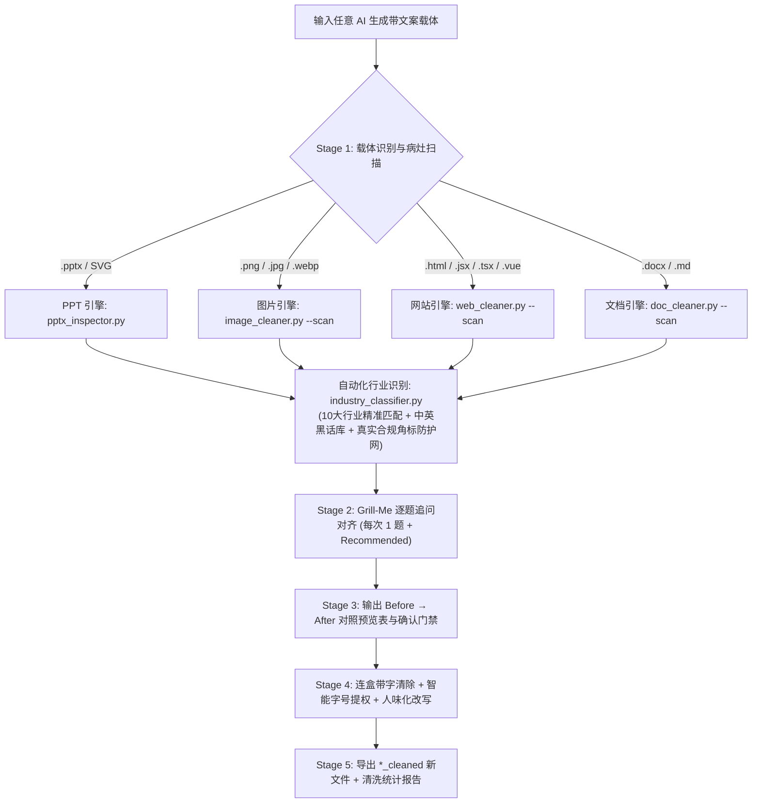

<div align="center">

# 🧹 AI Clean Master (`ai-clean-master`)

**全载体「去 AI 味小字连盒清理 + 视觉提权 + 人味化改写」大师技能**  
*All-Carrier AI-Slop Micro-Copy Cleaner, Visual Promoter & Copy Humanizer Skill*

[**简体中文**](./README.md) | [**English**](./README_EN.md)

[](LICENSE)
[](#五-10-大行业中英双语专业词库与合规防护矩阵)
[](#四-四大载体专属清理引擎与自动化识别流程)
[](#三-主流-ai-agent-全平台安装与适配指南)

</div>

---

## 一、为什么你需要 `ai-clean-master`？

无论你是用 AI 生成 **PPT 演示文稿**、**信息图海报**、**网页/参赛原型 Demo**，还是 **Word/Markdown 文档**，生成物往往带着强烈的**「AI 流水线塑料味（AI Slop）」**：

1. **满屏毫无信息增量的「AI 味小字」与胶囊框**：
   - **顶部伪英文与八股眉题**：标题头上永远顶着一个圆角胶囊框 `SECTION 01 · STRATEGIC OVERVIEW`、`CORE INSIGHT`、`✨ Next-Gen AI Platform`、`SYSTEM ONLINE`、`核心赋能模块`；
   - **卡片内同义反复的凑数解释小字**：卡片大标题已经写明「双目识别速度提升 3 倍」，下面偏要塞两行 `10pt` / `text-xs` 的废话把标题用“通过引入高效机制实现了…”复述一遍；
   - **页脚/底栏的假大空总结与假免责废话**：页面最底下永远横着一条 `本页核心洞察：通过多维抓手实现全链路闭环`、`注：以上数据仅供演示参考` 或网页假命令行状态栏；
   - **伪造的微数据角标与表情符号污染**：角落里塞满 AI 自己瞎编的 `+99.8% EFFICIENCY` 角标，以及满屏的 `✨🚀💡⚡` 表情和廉价紫青霓虹发光。
2. **张口闭口都是「中英文黑话与八股」**：
   - 中文高频黑话：**赋能、抓手、闭环、全链路、多维度、全方位、底层逻辑、顶层设计、范式转移、生态体系、协同共振、颗粒度、组合拳**；
   - 英文高频黑话：**`delve into`, `testament to`, `rich tapestry`, `paradigm shift`, `holistic ecosystem`, `synergy`, `empowering`, `game-changer`**。
3. **传统改写只删文字，导致版面留下「空色块」和「大片空洞」**：
   - 只清空文本框会在 PPT 或海报上留下一堆空荡荡的胶囊背景框和底栏色块；只删掉卡片小字会让卡片下半截空空如也。

---

## 二、四大核心能力

- 🗑️ **连盒带字一起清（Box-and-Text Removal）**  
  自动通过包围盒几何重叠算法（PPTX `paired_bg_shape_id`）、DOM 节点树匹配（Web）或外扩像素环背景采样（Image），在删除伪英文眉题、角标和底栏废话时，**将其背后的胶囊背景框、底栏横条一并彻底移除**，绝不留空盒子。
- 🔼 **智能视觉提权（Smart Visual Promotion）**  
  删掉卡片内凑数的解释小字后，自动将保留的核心观点**字号放大（如 PPT `+2pt ~ +4pt`、网页 `text-base → text-lg font-bold`）、行距放宽并垂直居中**，靠精炼有力的大字本身撑起饱满版面。
- 🗣️ **10 大行业中英双语去黑话 + 真实专业术语白名单（10-Industry Bilingual Parity）**  
  内置覆盖 10 大主流行业的专业词库与真实语感（详见 [`references/industry-playbooks-bilingual.md`](./references/industry-playbooks-bilingual.md)），拒绝空泛八股，用真实母语从业者行话改写，并提供严密法定标准保护。
- 🤝 **融合 `grill-me` 逐题追问对齐 + `Before → After` 确认门禁**  
  扫描病灶后不盲目乱改，以 `grill-me` 方式**每次只问一题**（每题首项附 `(Recommended)` 推荐方案），对齐语感档位、清理激进度与真实数据去留，展示修改预览表经你确认后再输出 `*_cleaned.*` 新文件，**绝不覆盖原文件**。

---

## 三、主流 AI Agent 全平台安装与适配指南

### 0. 环境准备与一键克隆

```bash
# 使用 GitHub CLI 克隆
gh repo clone Clement-2333/ai-clean-master-
# 或使用 Git 克隆
git clone https://github.com/Clement-2333/ai-clean-master-.git
cd ai-clean-master-

# 安装 Python 依赖 (用于 PPTX / 海报图片 / 网页 / Word 自动化扫描与清理)
pip install python-pptx python-docx Pillow numpy
```

### 1. 一键全平台自动安装脚本（推荐）

本仓库内置跨平台安装器 [`scripts/install_skill.py`](./scripts/install_skill.py)，支持一键将技能部署到你机器上的所有主流 AI Agent：

```bash
# 一键安装到所有已支持 Agent 的全局配置目录 + 生成豆包工作台技能包
python scripts/install_skill.py --agent all --scope global

# 或仅安装到指定工具（支持逗号分隔）
python scripts/install_skill.py --agent antigravity,claude,codex,cursor,workbuddy,qoder,trae,doubao --scope global

# 或安装到某个具体项目工作区（自动写入 .cursor/rules、.trae/rules、.qoder/rules 等）
python scripts/install_skill.py --agent all --scope workspace --workspace-dir /path/to/your/project
```

### 2. 各主流 AI Agent 独立配置说明

| AI Agent 工具 | 全局技能路径 (Global Skill Path) | 项目工作区路径 / 规则适配器 (Workspace & Rule Adapter) |
|---|---|---|
| **Google Antigravity** | `~/.gemini/config/skills/ai-clean-master` | `<project>/.agents/skills/ai-clean-master` |
| **Claude Code** | `~/.claude/skills/ai-clean-master` | `<project>/.claude/skills/ai-clean-master` + [`CLAUDE.md`](./CLAUDE.md) |
| **OpenAI Codex** | `~/.codex/skills/ai-clean-master` | `<project>/.agents/skills/ai-clean-master` + [`AGENTS.md`](./AGENTS.md) |
| **Cursor** | `~/.cursor/skills/ai-clean-master` | `<project>/.cursor/rules/ai-clean-master.mdc`（源文件：[`adapters/cursor/ai-clean-master.mdc`](./adapters/cursor/ai-clean-master.mdc)） |
| **腾讯 WorkBuddy** | `~/.workbuddy/skills/ai-clean-master` | `<project>/.workbuddy/skills/ai-clean-master` 或 `<project>/.agents/skills/ai-clean-master` |
| **阿里 Qoder** | `~/.qoder/skills/ai-clean-master` | `<project>/.qoder/skills/ai-clean-master` + `<project>/.qoder/rules/ai-clean-master.md` |
| **字节 Trae** | `~/.trae/skills/ai-clean-master` | `<project>/.trae/skills/ai-clean-master` + `<project>/.trae/rules/ai-clean-master.md` |
| **豆包工作台 (Doubao)** | 导入 `dist/ai-clean-master-skill-bundle.zip` | 专属提示词与沙箱指南：[`adapters/doubao-workspace/doubao-skill-prompt.md`](./adapters/doubao-workspace/doubao-skill-prompt.md) |

---

## 四、四大载体专属清理引擎与自动化识别流程



### 0. 10 大行业中英双语自动识别引擎 (`industry_classifier.py`)
```bash
# 快速检测文案所属行业、主语言 (zh/en/bilingual) 与推荐人味语感
python -c "from scripts.industry_classifier import detect_industry_and_language; import json; print(json.dumps(detect_industry_and_language('P99 latency sub-20ms under high QPS load with zero-copy Kafka buffer'), ensure_ascii=False, indent=2))"

# 验证某段微文本是否属于严禁误删的行业真实合规标准（返回 True / False）
python -c "from scripts.industry_classifier import is_protected_domain_footnote; print(is_protected_domain_footnote('* SOC2 Type II Certified (FY2025); P99 latency < 18ms'))"
```

### 1. PPT 演示文稿引擎 (`pptx_inspector.py` + `pptx_cleaner.py`)
```bash
# 扫描 PPTX 中的 AI 味小字、黑话及配对胶囊背景框 (自动识别行业或使用 --industry 强制指定)
python scripts/pptx_inspector.py demo.pptx --industry healthcare_biotech --json scan.json

# 执行连盒删除、段内凑数小字清理、保样式人味改写与字号提权
python scripts/pptx_cleaner.py demo.pptx plan.json -o demo_cleaned.pptx
```

### 2. 网站与前端引擎 (`web_cleaner.py`)
```bash
# 扫描 HTML/React/Vue/SVG 中的 rounded-full 伪徽章、text-xs 凑数小字与 ✨🚀 噪音
python scripts/web_cleaner.py --scan index.html

# 执行 DOM 级连盒剥离、文案替换与核心字号 class 提权
python scripts/web_cleaner.py --apply web_plan.json index.html -o index_cleaned.html
```

### 3. 海报与信息图引擎 (`image_cleaner.py`)
```bash
# 智能采样外扩像素环，无痕擦除图中伪英文胶囊框与小字，并在原位放大重绘高清中文大字
python scripts/image_cleaner.py --apply img_plan.json poster.png -o poster_cleaned.png
```

### 4. 文档引擎 (`doc_cleaner.py`)
```bash
# 扫描并清理 Word (.docx) 与 Markdown (.md) 中的伪标签与中英文黑话
python scripts/doc_cleaner.py --scan report.docx
python scripts/doc_cleaner.py --apply doc_plan.json report.docx -o report_cleaned.docx
```

---

## 五、10 大行业中英双语专业词库与合规防护矩阵

`ai-clean-master` 拒绝一刀切的简单关键字替换，内置覆盖 10 大主流行业的专业词库与合规角标防护网（详见 [`references/industry-playbooks-bilingual.md`](./references/industry-playbooks-bilingual.md)）。系统能准确区分「无意义的 AI 塑料套话」与「严格受法律法规保护的真实专业术语」：

| 行业编号与领域 | ❌ 常见 AI 伪黑话（重点清理） | ✅ 真实行业专业术语（提倡与保护） | 🛡️ 严格保护的法定/合规标准与角标 |
|---|---|---|---|
| **01. 科技 / SaaS / AI**<br>`tech_saas_ai` | 智能底座、全栈赋能、算力闭环、颠覆性范式转移、生态共振、无缝协同、多维感知矩阵、高维赋能 | P99 延迟、吞吐量 (QPS/TPS)、冷启动耗时、首字时间 (TTFT)、Token 成本、显存占用 (VRAM)、水平自动扩缩容 (HPA)、零拷贝 (Zero-Copy) | ISO/IEC 27001, SOC2 Type II 审计标准, RFC 7519, IEEE 802.3, arXiv 预印本编号, SLA 99.95% (RTO < 15min) |
| **02. 智能制造 / 工业工程**<br>`industrial_manufacturing` | 智造新生态、工业大脑赋能、机电共振闭环、智慧车间新范式、数智化赋能支点、工业全栈底座 | 重复定位精度 (±0.02mm)、生产节拍 (CT 4.5s/件)、一次良品率 (FPY 99.4%)、整体设备效率 (OEE 88%)、PLC 软硬件双重互锁、常闭触点 (NC)、硬度 (HRC 58-62) | GB/T 1184-K, GB/T 1804-m, ISO 13849-1 (Cat.4 PLe), IEC 61131-3, CE 机械指令 2006/42/EC, FEA 应力仿真报告 |
| **03. 教育 / 科研 / 高校竞赛**<br>`education_academia` | 多维育人矩阵、赋能学业跃迁、双创生态闭环、打破认知壁垒、颗粒度对齐、教学范式重塑、素养飞轮 | 对照组实验、消融实验 (Ablation Study)、基准测试 (Benchmark)、样机物料清单 (BOM 成本 180 元)、信效度检验、方差分析 (ANOVA)、代码复现 | 国家自然科学基金 (NSFC 批准号), 重点研发计划, IEEE/ACM/NeurIPS 规范引用, Cronbach's α 信度, 显著性 (p < 0.01) |
| **04. 金融 / 投资 / 财税咨询**<br>`finance_consulting` | 价值重塑新范式、资本协同共振、全链路财富赋能、多维资产矩阵、金融科技飞轮、生态级赋能底座 | 净留存率 (NDR 118%)、客获成本回本周期 (CAC Payback 9个月)、息税折旧摊销前利润 (EBITDA Margin)、自由现金流 (FCF)、CAGR 34%、毛利基点 (320 bps) | GAAP / Non-GAAP 调节表, SEC Form 10-K / 10-Q 披露, 普华永道/德勤审计报告, Wind/Bloomberg 终端口径 |
| **05. 医疗健康 / 生物医药**<br>`healthcare_biotech` | 智慧康养新生态、生命健康全栈底座、数字医疗多维赋能、全生命周期健康闭环、精准医疗新范式 | 临床灵敏度 (96.4%)、特异度 (98.2%)、入组样本量 (n=1,280)、假阴性漏诊率 (<0.8%)、中位无进展生存期 (mPFS 14.2个月)、双盲对照、IC50 | 国家药监局 NMPA 三类注册证 (国械注准), FDA 510(k) / PMA 代码, IRB 伦理批件, 95% CI 置信区间, p < 0.001 |
| **06. 消费零售 / 品牌营销**<br>`retail_marketing` | 全域兴趣消费新生态、人货场多维赋能闭环、全渠道心智穿透、私域流量飞轮、触点共振、高潜客群深度破局 | 广告支出回报率 (ROAS 4.2)、30天复购率 (32.6%)、客单价 (AOV 186元)、自然流量占比 (45%)、坪效 (4.8万元/㎡/年)、存货周转天数 (38天) | 国家市场监管总局《广告法》合规审查, GB/T 消费品安全标准, 真实消费者测评授权, 真实 POS/ERP 交易流水核验 |
| **07. 政务民生 / 智慧城市**<br>`public_gov_smartcity` | 智慧政务全栈矩阵、数字孪生治理新生态、多维便民抓手闭环、数智中枢全方位赋能、城市大脑协同飞轮 | “一网通办”依申请事项、承诺办结时限由 15 天压至 2 天、“最多跑一次”实现率 (99.2%)、跨部门共享接口 42 个、群众好评率 (99.8%) | 国务院《优化营商环境条例》, 中办《党政机关公文处理工作条例》, GB/T 20988 等保三级, 严禁一切假英文角标 |
| **08. 建筑地产 / 空间设计**<br>`architecture_design` | 空间美学全景赋能、未来人居多维新生态、诗意栖居闭环、材质共振矩阵、立体交互范式跃迁 | 容积率 (FAR 2.2)、绿地率 (35%)、窗墙比 (0.28)、得房率 (83.5%)、6063 阳极氧化铝合金、CNC 精铣 R2.5 倒角、壁厚 1.8mm、采光系数 (2.5%) | GB 50096《住宅设计规范》, GB 50016《建筑设计防火规范》, LEED 金级 / 绿建三星, Revit BIM 施工图号, 结构抗震 8 度 |
| **09. 新能源 / 环保农业**<br>`energy_sustainability_agtech` | 绿色双碳生态赋能、零碳智慧全链路闭环、新能源多维矩阵、现代农业数字飞轮、立体碳中和底座 | 平准化度电成本 (LCOE 0.18元/kWh)、LFP 电芯 6,000 次循环容量保持率 > 80%、范围 1/2/3 年减排 12,400 吨 CO2e、滴灌节水 (38%)、亩产增产 (18.5%) | ISO 14064 碳核查认证, GHG Protocol 碳核算标准, 国家电网光伏并网检测 (GB/T 19964), 农业农村部绿色食品标准 (NY/T 391) |
| **10. 文娱传媒 / 游戏动漫**<br>`media_gaming_hospitality` | 沉浸式文旅新生态、全域互动价值飞轮、内容共振赋能矩阵、心智破圈闭环、泛娱乐多维生态底座 | 次日留存率 (D1 54% / D7 28%)、短视频完播率 (42%)、实机 4K 60fps 稳定运行、UE5 Nanite/Lumen 渲染、淡季客房入住率 (78%)、二消客单价 (68元) | 国家新闻出版署游戏版号 (国新出审), 广播电视节目制作经营许可证, A 级景区评定标准, DCI-P3 电影级色域认证, 原创版权登记号 (© 2026) |

---

## 六、效果对比示例（Before vs. After）

| 维度 | ❌ 清理前（典型 AI 塑料味） | ✅ 清理后（`ai-clean-master` 处理后） |
|---|---|---|
| **顶部眉题胶囊** | `[浅紫胶囊框] ✨ SECTION 01 · STRATEGIC OVERVIEW` | **连同浅紫胶囊背景框一并彻底删除**，归还顶部留白 |
| **卡片标题与内文** | 标题(16pt)：`多维感知赋能智慧农业新生态`<br>小字(10pt)：`通过引入全链路视觉算法抓手，全方位实现多维度分选效率的闭环提升。` | 删掉下方 10pt 凑数小字，主标题改写并**提权至 20pt 垂直居中**：<br>**`双目相机 + 轻量模型，0.2 秒挑出瑕疵果`** |
| **页面底栏** | `[深灰底栏横条] 本页核心洞察：构建全链路数字化闭环（注：数据仅供演示参考）` | **连同底部横条背景一并删除** |
| **法定与真实合规角标** | `* 依据 SOC2 Type II 审计标准无保留意见；P99 延迟 < 18ms (QPS=50k)` | **严格作为真实合规/技术证据保留**，绝不因处于底部而被误当作废话清除 |

---

## 七、测试验证

运行内置的四大载体端到端冒烟测试：

```bash
python scripts/test_smoke.py
```

---

## 八、仓库目录结构

```text
ai-clean-master-/
├── SKILL.md                                           # 核心技能指令（中英双语触发 + 五步工作流 + 10大行业映射）
├── AGENTS.md                                          # Codex / Antigravity / 通用 Agent 仓库规范入口
├── CLAUDE.md                                          # Claude Code 专属入口
├── README.md                                          # 中文完整文档
├── README_EN.md                                       # 英文完整文档 (English Documentation)
├── LICENSE                                            # MIT 开源许可证
├── adapters/                                          # 多平台 Agent 规则与提示词适配器
│   ├── cursor/ai-clean-master.mdc                     # Cursor .mdc 规则文件
│   ├── trae-qoder-workbuddy/ai-clean-master-rule.md   # Trae / Qoder / WorkBuddy 适配规则
│   └── doubao-workspace/doubao-skill-prompt.md        # 豆包工作台 (Doubao) 指南与系统提示词
├── references/
│   ├── industry-playbooks-bilingual.md                # 10 大行业中英双语去 AI 味与专业人味改写手册 (1:1 对等深度)
│   ├── ai-slop-dictionary.md                          # 中英双语 AI 味小字特征库 + 黑话表 + 四大场景人味字典
│   └── layout-promotion-rules.md                      # PPT/图片/网页/文档连盒清理几何判定与视觉字号提权规范
├── scripts/
│   ├── install_skill.py                               # 全平台 AI Agent 一键安装与打包脚本
│   ├── industry_classifier.py                         # 10 大行业中英双语自动识别器与真实合规角标防护网
│   ├── pptx_inspector.py                              # PPTX 病灶、配对背景框扫描器与行业识别器
│   ├── pptx_cleaner.py                                # PPTX 连盒删除、改写与字号提权执行器
│   ├── web_cleaner.py                                 # HTML/React/Vue/SVG 扫描与降噪提权器
│   ├── image_cleaner.py                               # 海报/信息图像素级无痕擦除与大字重绘器
│   ├── doc_cleaner.py                                 # Word (.docx) 与 Markdown 去 AI 味清理器
│   └── test_smoke.py                                  # 四大载体端到端冒烟测试脚本
└── tests/                                             # 单元测试与对抗性测试套件
```

---

## 📄 License

Released under the [MIT License](LICENSE).
