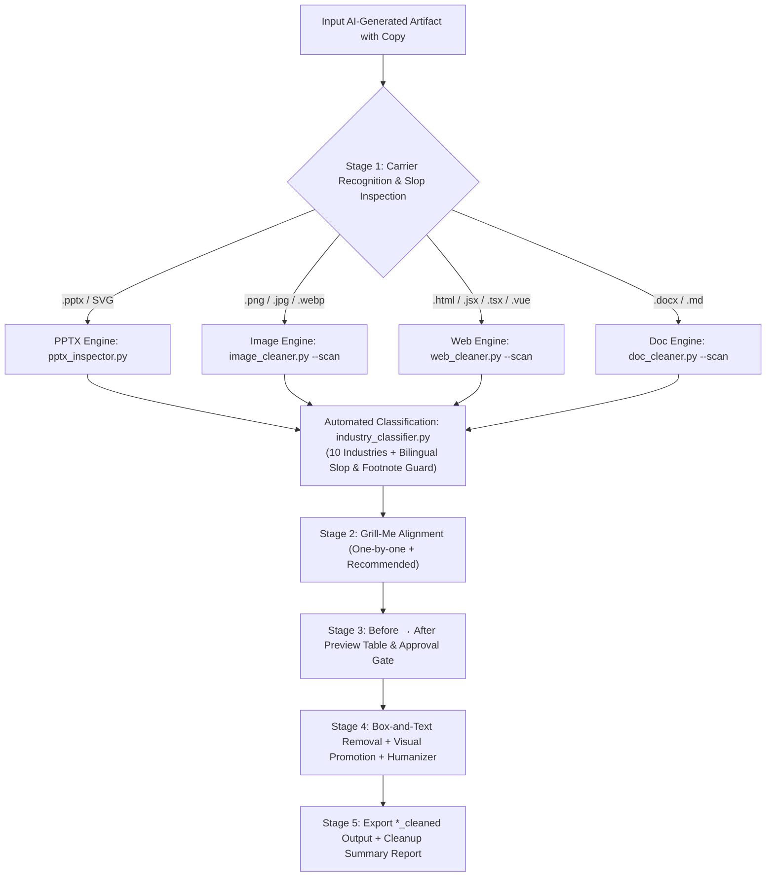

<div align="center">

# 🧹 AI Clean Master (`ai-clean-master`)

**All-Carrier AI-Slop Micro-Copy Cleaner, Box-and-Text Remover, Visual Promoter & Copy Humanizer Skill**  
*Works across **PPTX (`.pptx` / SVG)** · **Images (Posters / Infographics / Slide Captures)** · **Web UI (HTML / React / Vue / Tailwind)** · **Documents (`.docx` / Markdown)***

[**简体中文**](./README.md) | [**English**](./README_EN.md)

[](LICENSE)
[](#5-10-major-industries-bilingual-matrix--statutory-guard)
[](#4-four-carrier-specific-engines--automated-classification)
[](#3-multi-agent-installation--adaptation-guide)

</div>

---

## 1. Why `ai-clean-master`?

Whether you generate **PowerPoint decks (`.pptx`)**, **infographic posters (`.png`/`.jpg`)**, **landing pages / web prototypes (`.html`/`.tsx`/`.vue`)**, or **Word/Markdown documents** with AI, the output almost always suffers from unmistakable **"AI Slop"**:

1. **Cluttered, Zero-Information "AI Micro-Copy" & Decorative Pill Boxes**:
   - **Pseudo-English Kickers & Pill Badges**: Every heading has a glowing pill badge above it (`SECTION 01 · STRATEGIC OVERVIEW`, `✨ Next-Gen AI Platform`, `CORE INSIGHT`, `SYSTEM ONLINE`, `01 // FEATURE MATRIX`);
   - **Redundant Card Subtext**: A card title already states `"3x Faster Defect Detection"`, yet AI pads the bottom of the card with two lines of `10pt` / `text-xs` filler repeating the exact same idea in passive voice;
   - **Fake Footer Takeaways & Disclaimers**: Bottom banners stuffed with `"Key Takeaway: Empowering end-to-end digital transformation"` or `"Note: Data shown is for demonstration purposes only"`;
   - **Fabricated Micro-Metrics & Emoji Spam**: Ungrounded `+99.8% EFFICIENCY` corner tags and endless `✨🚀💡⚡` emojis.
2. **Robotic Buzzwords (Chinese & English)**:
   - English clichés: `delve into`, `testament to`, `rich tapestry`, `paradigm shift`, `holistic ecosystem`, `synergy`, `empowering`, `cutting-edge`, `game-changer`.
   - Chinese clichés: `赋能 (empower)`, `抓手 (lever)`, `闭环 (closed-loop)`, `全链路 (full-link)`, `底层逻辑 (underlying logic)`, `顶层设计 (top-level design)`.
3. **Text-Only Deletion Breaks Layouts**:
   - Simply deleting text leaves ugly empty colored pill shapes and footer bars floating on your slide or poster, and leaves cards looking half-empty.

---

## 2. Core Capabilities

- 🗑️ **Box-and-Text Removal (连盒带字一起清)**  
  Automatically pairs decorative micro-copy with its underlying background shape (`paired_bg_shape_id` via bounding-box IoA in `.pptx`, DOM badge wrappers in HTML/JSX, or border-ring pixel sampling in raster images) and deletes **both the text and its decorative box**, never leaving orphan shapes.
- 🔼 **Smart Visual Promotion (智能视觉提权)**  
  After stripping redundant subtext inside a card, automatically promotes the remaining core point's font size (e.g., `+2pt to +4pt` in PPTX, `text-base → text-lg font-bold` in Tailwind/CSS), relaxes line height, and vertically centers it so the layout feels bold, balanced, and intentional.
- 🗣️ **10 Major Industries Bilingual De-Slop & Statutory Guard (10 大行业中英双语专业词库与合规防护)**  
  Built-in knowledge base spanning 10 key industries (see [`references/industry-playbooks-bilingual.md`](./references/industry-playbooks-bilingual.md)), rejecting generic clichés, rewriting copy into authentic native professional phrasing, and protecting statutory standard footnotes.
- 🤝 **Built-in `grill-me` One-by-One Alignment & Confirmation Gate**  
  Interviews you **one question at a time** (with a `(Recommended)` first option) to align on tone, cleanup aggressiveness, and borderline real metrics, then presents a `Before → After` preview table for approval before outputting `<name>_cleaned.<ext>` (never overwrites original files).

---

## 3. Multi-Agent Installation & Adaptation Guide

### 0. Clone & Install Dependencies

```bash
# Via GitHub CLI
gh repo clone Clement-2333/ai-clean-master-
# Or via Git
git clone https://github.com/Clement-2333/ai-clean-master-.git
cd ai-clean-master-

# Install Python dependencies (for PPTX, Images, Web, and Word automation)
pip install python-pptx python-docx Pillow numpy
```

### 1. One-Click Cross-Agent Installer (Recommended)

Use [`scripts/install_skill.py`](./scripts/install_skill.py) to install `ai-clean-master` across all mainstream AI coding agents in one command:

```bash
# Install globally for all supported AI agents + build Doubao Workspace zip bundle
python scripts/install_skill.py --agent all --scope global

# Install for specific agents (comma-separated)
python scripts/install_skill.py --agent antigravity,claude,codex,cursor,workbuddy,qoder,trae,doubao --scope global

# Install into a specific project workspace (auto-generates .cursor/rules, .trae/rules, .qoder/rules)
python scripts/install_skill.py --agent all --scope workspace --workspace-dir /path/to/your/project
```

### 2. Supported AI Agents Matrix

| AI Agent Tool | Global Skill Path | Workspace Path & Rule Adapter |
|---|---|---|
| **Google Antigravity** | `~/.gemini/config/skills/ai-clean-master` | `<project>/.agents/skills/ai-clean-master` |
| **Claude Code** | `~/.claude/skills/ai-clean-master` | `<project>/.claude/skills/ai-clean-master` + [`CLAUDE.md`](./CLAUDE.md) |
| **OpenAI Codex** | `~/.codex/skills/ai-clean-master` | `<project>/.agents/skills/ai-clean-master` + [`AGENTS.md`](./AGENTS.md) |
| **Cursor** | `~/.cursor/skills/ai-clean-master` | `<project>/.cursor/rules/ai-clean-master.mdc` ([`adapters/cursor/ai-clean-master.mdc`](./adapters/cursor/ai-clean-master.mdc)) |
| **Tencent WorkBuddy** | `~/.workbuddy/skills/ai-clean-master` | `<project>/.workbuddy/skills/ai-clean-master` or `<project>/.agents/skills/ai-clean-master` |
| **Alibaba Qoder** | `~/.qoder/skills/ai-clean-master` | `<project>/.qoder/skills/ai-clean-master` + `<project>/.qoder/rules/ai-clean-master.md` |
| **ByteDance Trae** | `~/.trae/skills/ai-clean-master` | `<project>/.trae/skills/ai-clean-master` + `<project>/.trae/rules/ai-clean-master.md` |
| **Doubao Workspace (豆包工作台)** | Upload `dist/ai-clean-master-skill-bundle.zip` | Prompt & Sandbox Guide: [`adapters/doubao-workspace/doubao-skill-prompt.md`](./adapters/doubao-workspace/doubao-skill-prompt.md) |

---

## 4. Four Carrier-Specific Engines & Automated Classification



### 0. 10-Industry Automated Bilingual Classifier (`industry_classifier.py`)
```bash
# Detect industry context, primary language (zh/en/bilingual), and recommended tone from raw copy
python -c "from scripts.industry_classifier import detect_industry_and_language; import json; print(json.dumps(detect_industry_and_language('P99 latency sub-20ms under high QPS load with zero-copy Kafka buffer'), ensure_ascii=False, indent=2))"

# Check if a micro-copy string is a legally protected statutory standard or clinical metric (returns True/False)
python -c "from scripts.industry_classifier import is_protected_domain_footnote; print(is_protected_domain_footnote('* SOC2 Type II Certified (FY2025); P99 latency < 18ms'))"
```

### 1. PowerPoint Engine (`pptx_inspector.py` + `pptx_cleaner.py`)
```bash
# Scan a .pptx file for AI-slop micro-copy, buzzwords, and paired shapes (auto-detects industry or use --industry override)
python scripts/pptx_inspector.py deck.pptx --industry healthcare_biotech --json scan.json

# Apply box-and-text removal, sub-paragraph pruning, run-preserving rewrites, and font promotion
python scripts/pptx_cleaner.py deck.pptx plan.json -o deck_cleaned.pptx
```

### 2. Web & Frontend Engine (`web_cleaner.py`)
```bash
# Scan HTML/React/Vue/SVG for rounded-full badges, text-xs filler, and emoji spam
python scripts/web_cleaner.py --scan landing.html

# Apply DOM node removal, copy humanization, and typography class promotion
python scripts/web_cleaner.py --apply web_plan.json landing.html -o landing_cleaned.html
```

### 3. Raster Image / Poster Engine (`image_cleaner.py`)
```bash
# Erase baked-in pill badges/micro-copy via smart border-ring gradient interpolation & redraw promoted copy
python scripts/image_cleaner.py --apply img_plan.json poster.png -o poster_cleaned.png
```

### 4. Document Engine (`doc_cleaner.py`)
```bash
# Scan and clean Word (.docx) and Markdown (.md) files while preserving headings and tables
python scripts/doc_cleaner.py --scan report.docx
python scripts/doc_cleaner.py --apply doc_plan.json report.docx -o report_cleaned.docx
```

---

## 5. 10 Major Industries Bilingual Matrix & Statutory Guard

`ai-clean-master` rejects one-size-fits-all generic find-and-replace. It features a curated knowledge base spanning 10 key industries with explicit statutory footnote protection boundaries (see [`references/industry-playbooks-bilingual.md`](./references/industry-playbooks-bilingual.md)). The system strictly distinguishes hollow AI buzzwords from legally mandated professional terms:

| Sector # & Industry | ❌ Banned AI Slop & Buzzwords | ✅ Authentic Domain Terms (Promoted & Protected) | 🛡️ Protected Statutory Standards & Real Footnotes |
|---|---|---|---|
| **01. Tech, SaaS & AI**<br>`tech_saas_ai` | `next-gen paradigm shift`, `holistic AI ecosystem`, `seamless synergy`, `unleash limitless potential`, `hyper-intelligent`, `empower modern workflows`, `delve into AI solutions` | `sub-20ms P99 latency`, `Time-to-First-Token (TTFT)`, `QPS/TPS throughput`, `VRAM footprint`, `zero-copy buffer`, `horizontal pod autoscaling (HPA)`, `INT4/FP8 quantization` | ISO/IEC 27001, SOC2 Type II audit, RFC 7519 (JWT), IEEE 802.3, arXiv citations (`arXiv:2405.12345v2`), 99.95% SLA / RTO < 15 min |
| **02. Manufacturing & Automation**<br>`industrial_manufacturing` | `holistic smart manufacturing tapestry`, `seamless cyber-physical synergy`, `empowering shop-floor transformation`, `next-gen industrial paradigm`, `smart mechatronics catalyst` | `±0.02mm repeatability`, `4.5s cycle time (CT)`, `99.4% First Pass Yield (FPY)`, `88.5% OEE`, `dual hardware-software interlock`, `normally-closed (NC) contact`, `Rockwell hardness HRC 60` | ISO 2768-mK, ISO 13849-1 Cat.4 PLe (E-stop < 20ms), IEC 61131-3, CE Machinery Directive 2006/42/EC, Siemens S7-1500 Profinet 1.0ms cycle |
| **03. Education & Academia**<br>`education_academia` | `delve into the rich tapestry of learning`, `testament to academic excellence`, `holistic pedagogical paradigm`, `empowering student journey`, `transformative educational ecosystem` | `ablation study (+4.2% mAP)`, `field-tested across 142 students`, `$25 prototype BOM cost`, `control vs. experimental group`, `Cronbach's alpha 0.88`, `5-fold cross validation` | NSF Grant No. (62332001), paired t-test ($p < 0.01$), ImageNet-1K benchmark, NeurIPS/CVPR peer review, double-blind review protocols |
| **04. Finance, VC & Consulting**<br>`finance_consulting` | `paradigm-shifting capital synergy`, `holistic wealth tapestry`, `empowering value creation`, `unleashing financial potential`, `revolutionary FinTech flywheel` | `118% Net Dollar Retention (NDR)`, `9-month CAC payback`, `EBITDA margin`, `Free Cash Flow (FCF)`, `34% CAGR`, `320 bps margin expansion`, `LTV/CAC > 3.5x` | GAAP vs. Non-GAAP reconciliation table, SEC Form 10-K / 10-Q disclosures, PCAOB audited financials, Bloomberg/FactSet source terminal, Rule 10b-5 safe harbor |
| **05. Healthcare, Biotech & MedTech**<br>`healthcare_biotech` | `holistic wellness tapestry`, `empowering clinical journeys`, `transformative healing ecosystem`, `next-gen healthcare paradigm`, `seamless patient synergy` | `96.4% sensitivity`, `98.2% specificity`, `cohort sample size (n=1,280)`, `median progression-free survival (mPFS 14.2 mo)`, `IC50 3.2 nM`, `double-blind RCT`, `Grade 3/4 adverse events` | FDA 510(k) clearance (K234567) / PMA, NMPA Class III registration, IRB ethics approval, ClinicalTrials.gov (NCT04567890), 95% CI [1.8, 3.2], p < 0.001 |
| **06. Retail & Brand Marketing**<br>`retail_marketing` | `holistic retail tapestry`, `omnichannel customer synergy`, `empowering shopper journeys`, `seamless brand storytelling`, `transformative consumer touchpoints` | `4.2x blended ROAS`, `32.6% 30-day repeat purchase rate`, `Average Order Value ($186 AOV)`, `inventory turnover (38 days)`, `sales per square foot ($850/sqft)`, `12.4% cart-to-checkout conversion` | FTC Endorsement Guides (16 CFR Part 255 - `#ad` / `#sponsored`), Truth in Advertising compliance, audited POS transaction logs, CCPA/GDPR customer privacy notices |
| **07. Public Sector & Smart City**<br>`public_gov_smartcity` | `holistic civic tapestry`, `empowering municipal transformation`, `synergistic governance ecosystem`, `delve into smart city paradigms`, `transformative public administration` | `cut permit turnaround from 15 days to 2 days`, `inter-agency data integration across 42 bureaus`, `99.2% single-visit resolution rate`, `99.8% citizen satisfaction score`, `98.5% SLA municipal ticket dispatch` | State Administrative Procedure Act (APA), NIST SP 800-53 rev.5 FedRAMP High certification, Section 508 accessibility compliance, municipal FOIA audit requirements |
| **08. Architecture & Industrial Design**<br>`architecture_design` | `holistic spatial tapestry`, `empowering living experiences`, `poetic architectural synergy`, `transformative design paradigms`, `seamless materiality flywheel` | `Floor Area Ratio (FAR 2.2)`, `83.5% net usable floor ratio`, `0.28 window-to-wall ratio`, `6063-T6 anodized aluminum facade`, `1.8mm wall thickness`, `CNC-milled R2.5 chamfer`, `2.5% Daylight Factor` | International Building Code (IBC 2024), LEED Platinum / WELL Gold certification, ASHRAE 90.1 energy standard, stamped PE/AIA construction drawings (BIM Level 2) |
| **09. Clean Energy, ESG & AgTech**<br>`energy_sustainability_agtech` | `holistic sustainability tapestry`, `empowering green transitions`, `seamless eco-synergy`, `unleashing carbon-neutral potential`, `transformative green flywheel` | `Levelized Cost of Electricity ($0.028/kWh LCOE)`, `6,000-cycle LFP battery retention > 80%`, `12,400 tCO2e annual abatement`, `38% drip irrigation water savings`, `18.5% yield gain per acre` | ISO 14064-1/2 greenhouse gas verification, GHG Protocol Corporate Standard (Scope 1, 2 & 3 emissions), IEEE 1547 grid-tie interconnection standard, USDA Organic / EPA compliance |
| **10. Media, Gaming & Hospitality**<br>`media_gaming_hospitality` | `holistic entertainment tapestry`, `empowering immersive storytelling`, `synergistic player experiences`, `transformative creative journeys`, `next-gen gaming flywheel` | `D1 54% / D7 28% player retention`, `42% short-video completion rate`, `rock-solid 4K 60fps gameplay`, `Unreal Engine 5 Nanite/Lumen geometry`, `78% off-season hotel occupancy`, `secondary spend per guest ($68)` | ESRB / PEGI age rating clearance, SAG-AFTRA voice actor contract compliance, DCI-P3 cinematic color space verification, registered copyright (© 2026), Dolby Atmos audio mastering |

---

## 6. Showcase Examples (Before vs. After)

| Dimension | ❌ Before Cleaning (Typical AI Slop) | ✅ After Cleaning (`ai-clean-master` Applied) |
|---|---|---|
| **Top Kicker Badges** | `[Light Purple Pill Badge] ✨ SECTION 01 · STRATEGIC OVERVIEW` | **Entirely deleted together with its background pill shape**, restoring clean white space |
| **Card Heading & Micro-Copy** | Heading (16pt): *Multi-Dimensional Sensing Empowering Modern Industrial Synergy*<br>Micro-Copy (10pt): *By leveraging end-to-end computer vision paradigms, organizations can seamlessly facilitate holistic sorting efficiency.* | Redundant 10pt subtext stripped; core headline rewritten and **promoted to 20pt bold and vertically centered**:<br>**`Stereo Cameras + Lightweight Model: Defect Triage in 0.2s`** |
| **Page Footer Banners** | `[Dark Grey Banner] Key Takeaway: Constructing an end-to-end digital transformation closed loop (Note: Illustrative demo data only)` | **Entire banner bar and mock disclaimer removed entirely**, eliminating artificial bottom clutter |
| **Statutory / Compliance Footnotes** | `* SOC2 Type II Certified (FY2025); P99 latency < 18ms under 50k QPS` | **Strictly preserved as a verified audit footnote**; never falsely deleted as slop |

---

## 7. Verification

Run the self-contained 4-carrier smoke test suite:

```bash
python scripts/test_smoke.py
```

---

## 8. Repository Directory Structure

```text
ai-clean-master-/
├── SKILL.md                                           # Core skill instruction (bilingual trigger, 5-stage workflow, 10 industries)
├── AGENTS.md                                          # Codex / Antigravity / generic agent repository rules
├── CLAUDE.md                                          # Claude Code dedicated entrypoint
├── README.md                                          # Comprehensive Chinese documentation
├── README_EN.md                                       # Comprehensive English documentation
├── LICENSE                                            # MIT Open-Source License
├── adapters/                                          # Multi-agent platform rule adapters & prompt guides
│   ├── cursor/ai-clean-master.mdc                     # Cursor IDE .mdc rule definition
│   ├── trae-qoder-workbuddy/ai-clean-master-rule.md   # Trae / Qoder / WorkBuddy unified rule adapter
│   └── doubao-workspace/doubao-skill-prompt.md        # ByteDance Doubao Workspace prompt & sandbox guide
├── references/
│   ├── industry-playbooks-bilingual.md                # 10-industry bilingual de-slop & domain copy playbooks (1:1 parity)
│   ├── ai-slop-dictionary.md                          # Bilingual AI-slop pattern database, buzzwords & humanizer lexicon
│   └── layout-promotion-rules.md                      # Geometric box-pairing, visual hierarchy promotion & footnote rules
├── scripts/
│   ├── install_skill.py                               # One-click multi-agent installer and bundler
│   ├── industry_classifier.py                         # 10-industry bilingual classifier & compliance footnote guard
│   ├── pptx_inspector.py                              # PPTX slop scanner, box pairing & industry detection
│   ├── pptx_cleaner.py                                # PPTX box-and-text remover, copy rewriter & font promoter
│   ├── web_cleaner.py                                 # HTML/React/Vue/SVG DOM scanner and visual promoter
│   ├── image_cleaner.py                               # Pixel-level gradient interpolation & text redraw engine
│   ├── doc_cleaner.py                                 # Word (.docx) & Markdown (.md) de-slop cleaner
│   └── test_smoke.py                                  # End-to-end 4-carrier smoke test suite
└── tests/                                             # Unit and adversarial test suites
```

---

## 📄 License

Released under the [MIT License](LICENSE).
